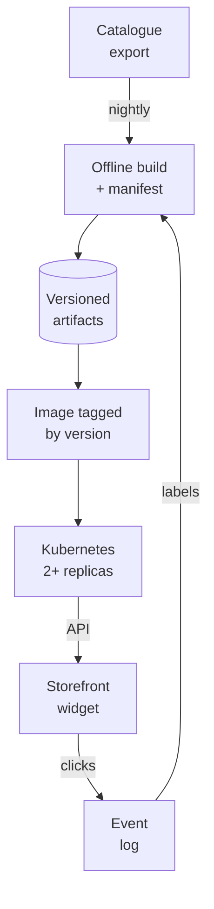

# Operating it: deploy, monitor, roll out, roll back

This document describes how the service moves from this repository to a customer's storefront, and the criteria for shipping,
stopping or rolling back a release. Items under "In the repository" are built and running here. "Proposed" marks the rollout plan for a customer.

## Where it sits in a customer's catalogue workflow

## In the repository

| Concern | What I built | Where |
|---|---|---|
| Which model is running | `model_version` is a hash of the data, the photo embeddings, the model config, the serving code and the pinned library versions in `requirements.txt`. Every response carries it as `X-Model-Version`, and `python -m simsearch.manifest` writes it into `k8s.yaml` as the image tag | `simsearch/manifest.py`, `config/manifest.json`, `app.py` |
| Is it the model I evaluated | At start-up the service re-hashes the files it loaded, checks every installed library against its pin, and compares both with the manifest. Any difference makes the instance degraded | `/api/status` (`manifest_verified`, `degraded_reasons`) |
| Missing data | Photo coverage is measured at start-up. Below 90% the instance reports itself degraded, and the demo warns that the saved quality numbers do not describe it | `/api/status`, demo header |
| Requests nobody can answer | Weights that select only attributes the product has no data for return 422, naming the attributes it does have, instead of a ranking of zeros | `engine.find_similar_products` (D26) |
| Health | `/health` for start-up and liveness. `/ready` returns 503 while degraded, so a pod that isn't serving the evaluated model gets no traffic. The image and manifest set a non-root user (UID 10001) and a read-only root filesystem; CI builds and smoke-tests the image | `k8s.yaml`, `Dockerfile`, `app.py` |
| Metrics | Prometheus text: requests by route and status (unmatched paths count as route "other"), latency p50 and p95, the degraded flag, photo coverage and model info | `/metrics` |
| Live quality | Two signals from traffic at the default settings. Requests that override the weights or the penalty are excluded, so experiments cannot move them. The wrong-type share is, among served results where both leaf categories are known, the share whose category differs from the query's. It tracks the category rule's own target, so it is a regression signal for that rule, compared with its own baseline. It is not a quality score. Catalogue exposure is the share of the catalogue recommended at least once since the process started. It can only grow within a process, so on its own it says nothing about a trend; a weekly view would need the set exported or reset per window (proposed) | `/metrics`, `/api/status` (`live_quality`) |
| Tracing | Every response carries `X-Request-ID`, or echoes the caller's if it looks like an id. An unexpected error returns a JSON 500 with that id, and the log has the same id next to the stack trace | `app.py` |
| Rollout safety | Rolling update with `maxUnavailable: 0`, so a new pod takes traffic only once it is ready | `k8s.yaml` |
| CI | Tests, a manifest check, the container build, and a smoke test of the endpoint, a 404, the status and the metrics | `.github/workflows/ci.yml` |
| Latency | 1.1 ms median in-process (exact search, cache bypassed). Over HTTP on one laptop with one worker: p50 3.7 ms on a cache miss, 1.5 ms on a hit, 20 ms with 8 concurrent clients. Measured on the host (Python 3.13), not inside the 3.12 image. Laptop timings vary by about 2× with power and thermal state | `results/evaluation.json`, `results/http_bench.json` |

## Runbooks

Rebuild for a new or changed catalogue:
1. Replace `data/archive.zip`, or point the loader at the new export.
2. Photos: `make images`, then `make embed` and `make export`. Unchanged products reuse the cached files.
3. Run `python tune.py` only if there are new labels; otherwise keep `config/model.json`.
4. Run `python evaluate.py`, compare with the previous `results/evaluation.json`, and stop if any gate below fails.
5. Run `python -m simsearch.manifest` to get the new `model_version`, build with
   `docker build -t product-similarity:<model_version> .`, and deploy.

Roll back: set `image:` in `k8s.yaml` back to the previous `model_version` tag and run `kubectl apply -f k8s.yaml`,
or `kubectl rollout undo deployment/product-similarity`. Tags are never reused, so the previous image is exactly the
previous model. Confirm with `curl /api/status` and the `X-Model-Version` header.

An instance reports degraded: read `degraded_reasons` in `/api/status`. Missing or changed artifacts mean the image
was built from the wrong files, so roll back. Low photo coverage after a catalogue refresh means the download or
embedding step failed, so rerun it before shipping.

## Proposed: offline gate, then shadow, then an A/B test

Offline gate, before any traffic. A new model ships only if, on fresh queries that no choice has touched, all of
these hold:
- The share of labelled results called a substitute is not lower than the current model's (the 95% CI of the difference
  stays above −2 points).
- The share of labelled results called a wrong product type or a duplicate is not higher.
- Co-purchase nDCG@10 falls by no more than 0.02. It measures "related", and a small loss is the expected price of
  preferring substitutes (D19).
- The model passes CI, and its manifest verifies.

Shadow test, one week. Run the candidate next to the live model on real product-page requests without showing
it, log both lists, and check p95 latency, the error rate and how often the two disagree in the top 5, then look at a
sample of the disagreements by hand.

A/B test. Randomise by shopper, 50/50, for two weeks or until the planned sample size is reached.

| | Metric | Decision rule |
|---|---|---|
| Primary | Click-through on the "Similar products" widget, and add-to-cart from it, per product-page view | Ship if add-to-cart from the widget rises and its 95% CI excludes zero |
| Guardrail | Overall conversion per session | Must not fall, because the widget must not take sales from the product being viewed |
| Guardrail | p95 latency under 50 ms at the service, 5xx rate under 0.1%, no degraded instances | Any breach: roll back immediately |
| Guardrail | Share of widget impressions with a wrong-type result, sampled and labelled daily | Must not rise |
| Stop | The primary metric is flat after the planned sample, or any guardrail is breached | Roll back to the previous `model_version` |

The click and add-to-cart logs from the test would then give the labels this dataset lacks: substitution behaviour
(viewed A, bought B instead) rather than co-purchase. Those are the labels that would justify revisiting the image
adapter and learning-to-rank (DESIGN.md, "Next steps").

## Monitoring checklist: drift, latency, accuracy, cost, bias

| Signal | In the repository | Alert, proposed |
|---|---|---|
| Latency | p50 and p95 in `/metrics` | p95 above 50 ms for 5 minutes |
| Errors | 5xx count by route | A 5xx rate above 0.1% |
| Accuracy (online proxy) | Live wrong-type share (category mismatch, not a labelled result) | A sustained step change against its own baseline from the first week of traffic. A threshold in points requires that baseline first. The offline labelled share measures a different quantity and cannot set it |
| Data drift | Photo coverage at start-up (degraded below 90%), and the wrong-type share after each catalogue refresh | A coverage drop, or a step change in wrong-type share right after a rebuild |
| Bias and concentration | Catalogue exposure since process start | Proposed: export the exposed set per fixed window (for example a week) and alert when exposure falls between windows with similar request counts |
| Cost | CPU only, no GPU at serving. One uvicorn worker in the Docker image answers 2.8 ms p50 and about 350 requests per second on a 2-vCPU runner (`results/http_bench_docker.json`) | Size replicas for availability first; compute is not the cost driver at this scale |

## Scaling

- The Docker image, benchmarked in CI on every push: one uvicorn worker answers an uncached request in 2.8 ms p50
  and 3.2 ms p95, about 350 requests per second, with zero errors (`results/http_bench_docker.json`). Queries are
  CPU-bound, so throughput scales with replicas and workers.
- When to switch to HNSW. Exact search grows linearly with the
  catalogue. At 30,000 products it takes about 1.1 ms, and HNSW saves under 0.1 ms while missing about 4% of the
  exact top 10 (`results/evaluation.json`). Before switching, measure the latency and recall@10 of both at
  100k, 300k and 1M synthetic products on the target hardware, and switch where exact search's p95 crosses the
  latency budget.
- Many customers: one artifact set per customer catalogue, built by the same pipeline, with the customer id in the
  manifest. The weights could be shared until a customer has enough labels of their own.
