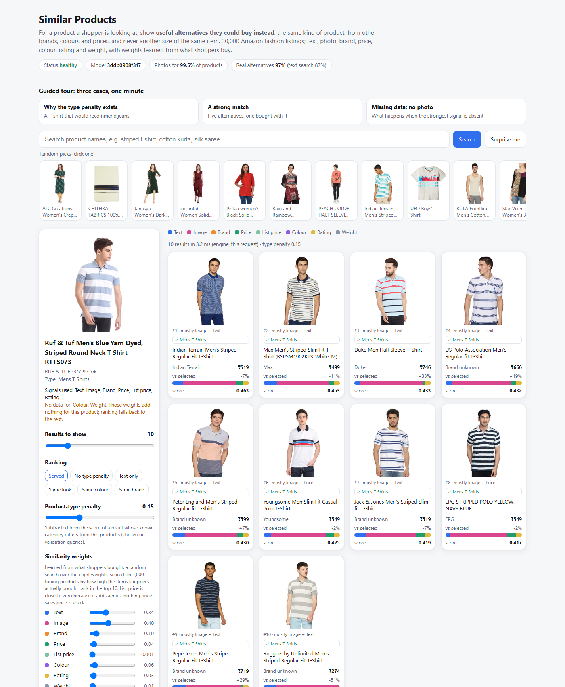
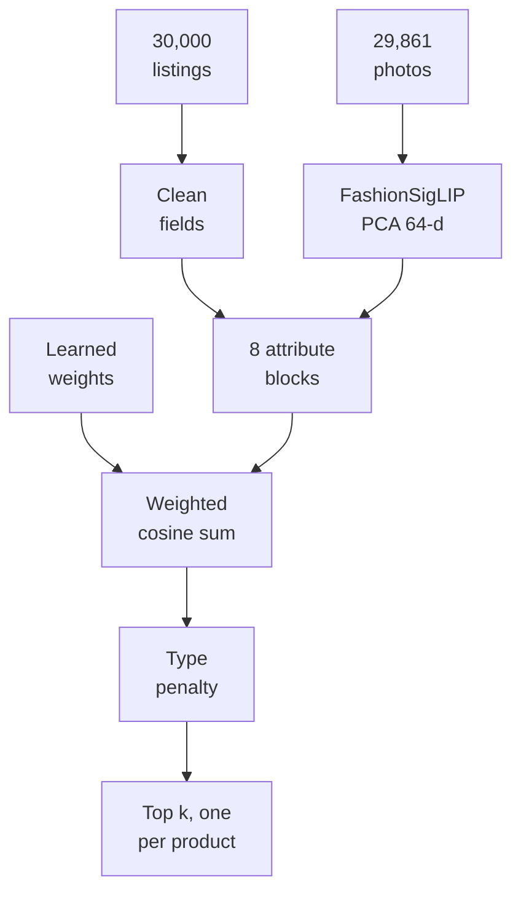

# Product similarity search

Given a product's `uniq_id`, return the products a shopper could buy instead: the same kind of product, from other
brands, colours and prices. Built for the [SAP technical exercise](https://github.com/punitmishra/sap-cxii-tech-ex-01)
on 30,000 Amazon fashion listings, served by FastAPI, shipped as a Docker image and deployed to Kubernetes in CI.

## Start here

- **Interactive demo:** start the service ([Quick start](#quick-start)) and open <http://localhost:8000/>: search
  the catalogue, choose how many results to show, see every score split by attribute and re-weight it live.
- **Results:** [hand labels](results/human_check/human_eval.md) · [co-purchase evaluation](results/evaluation.md)
- **Design decisions:** [DESIGN.md](DESIGN.md) · **Deployment and monitoring:** [OPERATIONS.md](OPERATIONS.md)
- **Automated checks:** [GitHub Actions](https://github.com/OmRajeshPawar/sap-cxii-tech-ex-01/actions): tests, Docker build and
  benchmark, Kubernetes deployment

| | Text-only TF-IDF | Hand-set weights | **This model** |
|---|---|---|---|
| Results that are a real alternative (199 results checked by hand, blind to the system) | 87.3% | – | **96.8%** |
| Top 10 contains a product shoppers actually bought (6,561 held-out products) | 56.2% | 61.1% | **64.4%** |
| Latency, exact search over the full catalogue | | | **1.1 ms** in-process; **2.8 ms** p50 over HTTP from the Docker image on a 2-vCPU runner |

Every measure is defined in plain English in [DESIGN.md](DESIGN.md#how-quality-is-measured).



What sets it apart:

- Photos are part of the served ranking: [Marqo-FashionSigLIP](https://huggingface.co/Marqo/marqo-fashionSigLIP) embeddings for 29,861 products, compressed to 64 dimensions.
- Eight attribute blocks with weights learned from what shoppers bought, not set by hand.
- A product-type penalty and one-listing-per-product rule, so a striped T-shirt returns T-shirts, not jeans or the same shirt in another size.
- Every score splits exactly into per-attribute parts, and the weights can be changed per request.
- Exact search by default, FAISS HNSW optional; a model version on every response and a readiness check that takes an instance with mismatched files out of rotation.

## Quick start

```bash
docker build -t product-similarity . && docker run -p 8000:8000 product-similarity
```

Or without Docker (Python 3.12):

```bash
pip install -r requirements-dev.txt
uvicorn app:app --port 8000
python -m pytest -q        # 346 tests
```

The function is `from simsearch.engine import find_similar_products, calculate_similarity`. The demo at
<http://localhost:8000/> adds live weight sliders and a guided tour.

### API examples

```bash
curl "http://localhost:8000/find_similar_products?product_id=2852dde03bc410bd2c8cf09db9ff674c&num_similar=5"
```
```json
["0cfc707a5c527bd547cff0df356766b8","5331adbd8e70cd0a2b166ceafd105b1f","71641dc241d4cd9c18a5fb49689f515e","b0f213843a1e18b86ba31a39d2a44007","4c0f3ec946516d31867915dc8d5a5620"]
```

`num_similar` is optional: it defaults to 10 and has no upper limit. `weights=` re-weights the attributes for one request, with no retraining. Here photo 0.6 and text 0.4 give a different list:

```bash
curl "http://localhost:8000/find_similar_products?product_id=2852dde03bc410bd2c8cf09db9ff674c&num_similar=5&weights=image:0.6,text:0.4"
```
```json
["9cc3c3916fc0912dc56b04ac2b829d72","c6a37656580e5f9ddfdb5a52ae90e419","71641dc241d4cd9c18a5fb49689f515e","c4fa5ccd0aec0fb87f134528be0f8c7c","5331adbd8e70cd0a2b166ceafd105b1f"]
```

Errors are specific:

```bash
curl -i "http://localhost:8000/find_similar_products?product_id=invalid_product&num_similar=5"   # 404
{"detail":"Product 'invalid_product' not found"}
curl -i "http://localhost:8000/find_similar_products?product_id=2852dde03bc410bd2c8cf09db9ff674c&num_similar=0"   # 422
{"detail":[{"type":"greater_than_equal","loc":["query","num_similar"],"msg":"Input should be greater than or equal to 1","input":"0","ctx":{"ge":1}}]}
```

## How it works



1. **Eight attribute blocks:** text (name and category, TF-IDF), photo, brand, sales price, list price, colour, rating
   and weight. Prices and weights become equal-population bands with partial credit for neighbours, because raw
   prices are heavily skewed. A missing value is an empty block, so it never counts as a match.
2. **One score that explains itself:** each block is L2-normalised and scaled by √weight, so a single sparse dot
   product equals the weighted sum of cosines and splits exactly into per-attribute parts.
3. **Weights learned from behaviour:** 12,193 products list what shoppers bought alongside them. Random search on 1,000
   tuning queries drawn from those labels sets photo 0.40, text 0.34, brand 0.10, colour 0.06, price 0.04, rating 0.03, weight 0.01, list price 0.001.
4. **Substitutes, not complements:** a product of a different category loses 0.15, and where a category is missing,
   a clash of wearer or type words in the names (men's vs women's, T-shirt vs jeans) loses 0.10. A striped T-shirt
   returns T-shirts, not the jeans people buy with it.
5. **One listing per product:** listings that share a name, a size-stripped name or an identical photo count as one,
   so the top 10 never repeats an item in another size.
6. **Photos without PyTorch in production:** four encoders were compared (ResNet-50, DINOv2, SigLIP 2,
   Marqo-FashionSigLIP). The winner's embeddings ship as a 4 MB file, so the API image stays small and starts fast.

## The brief, item by item

| Brief asks for | Where |
|---|---|
| `find_similar_products(product_id, num_similar) -> List[str]`, `calculate_similarity` | `simsearch/engine.py` |
| Brand, color, price, image, sales_price, weight, rating | One block each, plus name and category text (DESIGN.md D5) |
| Similarity measure, sorted descending, tie-breaker | Weighted cosine; ties go to rating, then id |
| `GET /find_similar_products` in FastAPI with proper error codes | `app.py`: 404, 422, JSON 500 with a request id |
| Docker image deployable on Kubernetes | `Dockerfile`, `k8s.yaml`; CI builds the image, benchmarks it and deploys it to a kind cluster |
| ANN (FAISS / HNSW), dimensionality reduction, caching | FAISS HNSW with exact re-rank (`SEARCH_MODE=hnsw`); PCA for photos; LRU cache |
| Text similarity | TF-IDF; transformer text embeddings compared on validation (DESIGN.md D7) |
| Image similarity with a pre-trained network | Four encoders compared on 29,861 photos (DESIGN.md D10) |
| Combined score, configurable weights, fallback | Learned weights, `?weights=` per request, empty blocks for missing data |
| Design decisions and trade-offs | [DESIGN.md](DESIGN.md), [OPERATIONS.md](OPERATIONS.md) |

**Bonus, HNSW** (Malkov & Yashunin, TPAMI 2020, [arXiv:1603.09320](https://arxiv.org/abs/1603.09320)) via [FAISS](https://arxiv.org/abs/2401.08281):
SVD to 256 dimensions, HNSW proposes 200 candidates, exact scores re-rank them. It returns 96.2% of the exact top 10.
At 30,000 products exact search is already about a millisecond, so exact is the default and HNSW is one environment
variable away for larger catalogues.

## Production

Every response carries the model version (a hash of data, embeddings, weights, serving code and pinned library
versions) in `X-Model-Version`, and the same hash tags the image. An instance whose files or installed libraries don't
match that version reports itself degraded and `/ready` takes it out of rotation. `/metrics` exports Prometheus latency, error, coverage and
wrong-type signals. The container runs as a non-root user, with a read-only root file system in Kubernetes. Rollout, rollback and the A/B
plan are in [OPERATIONS.md](OPERATIONS.md).

## Limitations

- **"Similar" has more than one meaning.** A red men's shirt is similar to a men's T-shirt as a garment, to a red
  sweatshirt by colour, and to jeans by what people buy together. The default answers "buy instead", the use behind a
  product-page widget; `?weights=` and `?category_penalty=0` serve the other readings.
- **The data needs heavy cleaning and has no relevance labels.** 79% of weights are a placeholder value, 27% of
  brands and 80% of colours are missing, 15% of products have no category, and sizes are listed as separate products.
  Co-purchase lists are the only behavioural signal, and they mix substitutes with complements, so quality is
  checked with hand labels ([analysis/data_report.md](analysis/data_report.md)).

## Repository

| Path | Contents |
|---|---|
| `simsearch/` | Data cleaning, attribute blocks, scoring and ranking, labels and metrics, model manifest, HNSW |
| `app.py`, `demo.py`, `web/` | API, health, readiness, metrics and the demo UI |
| `tune.py`, `evaluate.py`, `tools/` | Weight learning, evaluation, photo pipeline, hand-label scoring, benchmarks |
| `results/` | Every reported number, including the hand labels |
| `analysis/` | Data exploration report and charts |
| `Dockerfile`, `k8s.yaml`, `.github/workflows/ci.yml` | Container, cluster manifest, CI |
