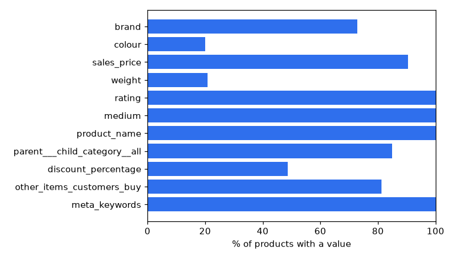
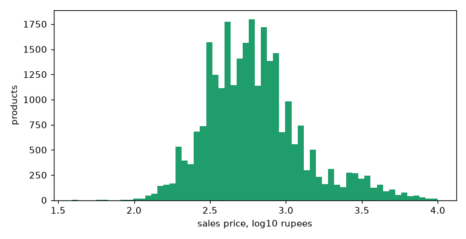
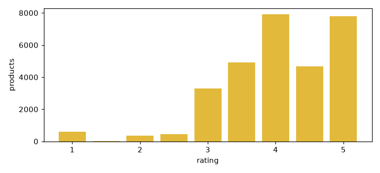
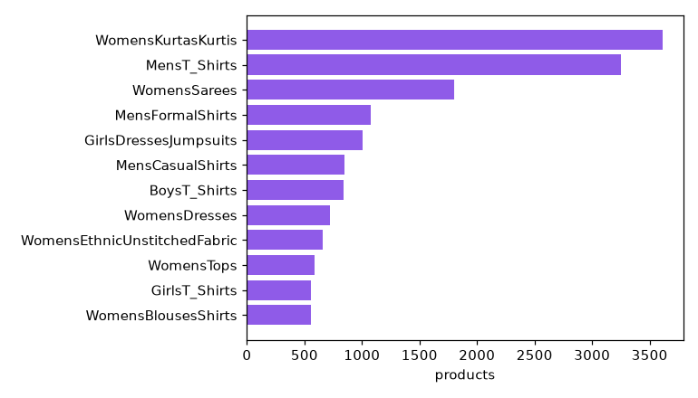

# Data report

30,000 products, 33 distinct fields. Source: `data/archive.zip`.

## 1. Reliable fields
- `brand`: 73% filled
- `colour`: 20% filled
- `sales_price`: 90% filled
- `weight`: 21% filled with a real value (the rest is the placeholder 999999999)
- `rating`: 100% filled
- `medium`: 100% filled
- `product_name`: 100% filled
- `parent___child_category__all`: 85% filled
- `discount_percentage`: 49% filled
- `other_items_customers_buy`: 81% filled
- `meta_keywords`: 100% filled

## 2. Weight: what do the values look like?
- `999999999` appears in 23,745 of 30,000 (79%). That is a placeholder, not a weight: read as a number it would make most products 'identical' on weight. Decision: treat it as unknown.
- The real values mix units: 'g' (6113), 'grams' (121), 'kilograms' (11), 'kg' (9), plus a few free-text entries. Decision: convert units to grams; anything unparseable is unknown.

## 3. Brand: how often is it missing, and what does missing look like?
- Empty in 8,143 of 30,000 (27%); placeholders: {'generic': 245, 'unknown': 62, 'n/a': 4}.
- Decision: empty and placeholder brands are *unknown*, and unknown never counts as a match. An 'Unknown' brand value would make thousands of unbranded products look alike.
- 6,338 distinct brands; the 10 largest cover 6% of products, so brand is a long tail.

## 4. Colour: sparse and multi-valued
- Filled in 6,029 of 30,000 (20%). Every filled value is a `|`-separated list (median 3, up to 80 entries), so the field holds the *colour options the product is sold in*, not the colour of this listing.
- Decision: split into individual colours and compare the sets (two products sold in similar colours). It is a weak signal, and a missing colour adds nothing to a score.

## 5. Prices: skew, and the missing 'price' column
- `sales_price` parses for 27,110 of 30,000 (90%). Percentiles 5/25/50/75/95/99: ₹219, ₹379, ₹590, ₹899, ₹2,877, ₹5,220. The top 1% is far above the median.
- Decision: compare prices by equal-population bands, not raw values, so ₹300 vs ₹30,000 is not dominated by a few luxury items, and give partial credit to neighbouring bands so ₹499 vs ₹501 is close.
- The brief lists both `price` and `sales_price`, but there is no `price` field. `discount_percentage` is filled in 14,624 of 30,000 (49%), so the list price is derived as sales price / (1 - discount).

## 6. Ratings: where do they sit?
- 30,000 of 30,000 (100%) have a rating; 25% are exactly 5.0 and the median is 4.0. Decision: half-star bands with neighbour credit, and rating as the tie-breaker.

## 7. Categories: keys or values?
- Example: `{'ClothingAccessories': '#19,259', 'WomensKurtasKurtis': '#1793'}`. The keys say what the product is; the values are sales ranks (popularity), so I use the keys as text, split on CamelCase (`WomensKurtasKurtis` -> 'Womens Kurtas Kurtis').
- 4,503 of 30,000 (15%) have no category at all. 219 distinct leaf categories; largest: WomensKurtasKurtis (3,610), MensT_Shirts (3,251), WomensSarees (1,802), MensFormalShirts (1,074), GirlsDressesJumpsuits (1,005).

## 8. Is the same product listed more than once?
- 451 ASINs appear more than once.
- 2,531 normalised names repeat, covering 10,462 listings (sizes and colours listed separately).
- Removing size words, age ranges, pack counts and bracketed SKU codes leaves 20,972 product families from 22,069 names. Example: `Max Men's Striped Slim Fit T-Shirt (BSPSM1902KTS_White_M)` and `(..._2XL)` are one family.
- Decision: show one listing per product, or a shopper sees the same T-shirt in four sizes.

## 9. Photos
- 29,998 of 30,000 (100%) have at least one image URL. The first `medium` URL is the product photo I embed. Some URLs fail to download, so the photo pipeline records which products really have a photo, and a product without one falls back to its other attributes.

## 10. Ground-truth candidates
- `other_items_customers_buy` is filled for 24,363 of 30,000 (81%), with 9.1 names per row on average.
- 46% of those names match a product in this catalogue, and 19,874 products have at least one match. Keeping one query per product name and dropping matches to the query's own name leaves 12,193 labelled queries (`simsearch/labels.py`).
- Because this is real shopper behaviour, it serves as weak relevance labels. It is never used as a feature, since the model would then be scored on its own input. Note that 'also bought' is mostly same-category alternatives, with some complements mixed in.

## 11. Text: which fields describe the product?
- `meta_keywords` is the product name plus a few seller words: in 42% of rows it adds no new word at all, and the median row adds 11% new words. Names are 8 words long (median). Decision: TF-IDF on name + category text; keywords left out.

## 12. Cleaning functions checked against this report
- PASS: placeholder weights become unknown
- PASS: every real weight is in grams and positive
- PASS: placeholder brands are unknown
- PASS: multi-colours are split
- PASS: list price is derived from the discount
- PASS: weights with units convert
